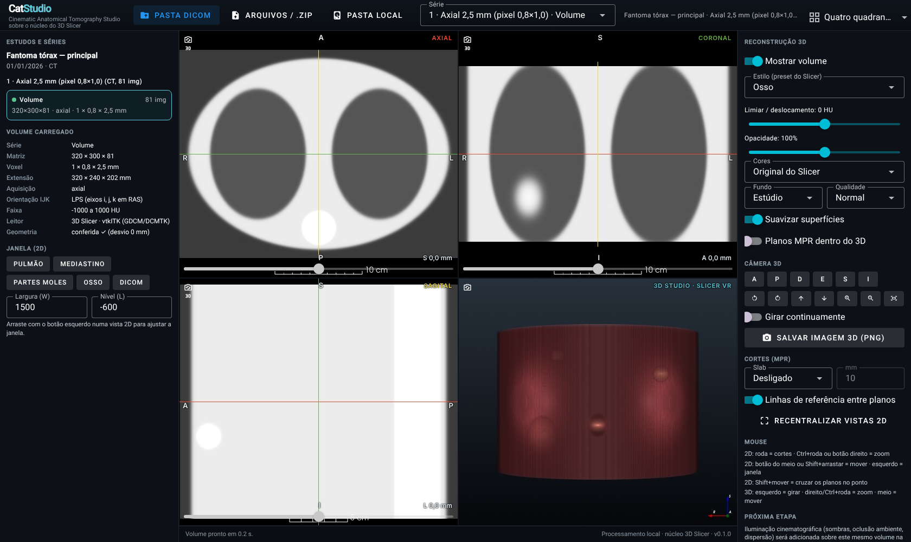

# CatStudio — Cinematic Anatomical Tomography Studio

Estúdio **web** de tomografia construído sobre o **núcleo oficial do 3D Slicer**. O servidor roda no seu computador,
usa as bibliotecas do Slicer para ler o DICOM, fatiar e renderizar o volume em 3D, e a interface abre no navegador.

**Etapa 1 — fundação:** importação DICOM, MPR axial/coronal/sagital, reconstrução volumétrica 3D real (ray casting
GPU do Slicer), presets 2D e 3D, controles de rotação, zoom, opacidade e cores. Iluminação cinematográfica é a Etapa 2.



> Ferramenta de pesquisa, ensino e apresentação. Não é dispositivo médico e não deve ser usada para diagnóstico.

## Arquitetura (resumo)

```
navegador (Vue/Vuetify via trame)  ⇄ websocket ⇄  servidor Python local
                                                  ├─ catstudio            interface, catálogo DICOM, estilos, conferência geométrica
                                                  ├─ trame-slicer 2.0.0   ponte oficial da Kitware entre o Slicer e a web
                                                  └─ slicer-core 5.11.0.6 núcleo do 3D Slicer: MRML, lógicas, vtkITK (GDCM/DCMTK),
                                                                          fatiamento, volume rendering GPU, presets
```

- **Nenhuma linha do Slicer foi alterada**; o núcleo é instalado pelo `pip` como biblioteca.
- Escolhido no lugar de uma *Custom Slicer Application* (desktop, exige compilar o Slicer inteiro) e de uma extensão
  Python (continua sendo o Slicer desktop). Auditoria completa e justificativa: [`docs/ARQUITETURA.md`](docs/ARQUITETURA.md).
- Licenças: [`LICENCAS.md`](LICENCAS.md).

## Como executar no Windows

Requisitos: Windows 10/11 64 bits, placa de vídeo com OpenGL 3.2 ou mais recente (qualquer Intel/AMD/NVIDIA dos
últimos anos), 8 GB de RAM (16 GB para exames de 0,6 mm), cerca de 1 GB livre.

1. Instale o **Python 3.12** de <https://www.python.org/downloads/windows/> e marque **"Add python.exe to PATH"**
   (3.10, 3.11 e 3.13 também servem; 3.14 ainda não tem os pacotes do Slicer).
2. Copie a pasta `catstudio` para o computador (por exemplo `C:\CatStudio`).
3. Dê dois cliques em **`instalar.bat`**. Ele cria um ambiente `.venv` e baixa o núcleo do Slicer (~400 MB, uma vez só).
4. Dê dois cliques em **`CatStudio.bat`**. O navegador abre em <http://127.0.0.1:8765>.
5. Para fechar, feche a janela preta do terminal (ou `Ctrl+C` nela).

Pela linha de comando (PowerShell, dentro da pasta):

```powershell
py -3.12 -m venv .venv
.venv\Scripts\python -m pip install -e .
.venv\Scripts\python -m catstudio                      # abre o navegador
.venv\Scripts\python -m catstudio --open "D:\Exames\TC" # já importa uma pasta
.venv\Scripts\python -m catstudio --port 9000 --no-browser
```

Por padrão o servidor só aceita conexões **deste computador** (127.0.0.1). `--host 0.0.0.0` expõe na rede; faça isso só
em rede confiável, porque o exame passa por essa máquina.

## Como usar

1. **Importar:** *Pasta DICOM* (envia a pasta pelo navegador), *Arquivos / .zip*, ou *Pasta local* (cola o caminho de
   uma pasta do disco; mais rápido para exames grandes porque os arquivos são lidos no lugar).
2. **Escolher a série** na lista à esquerda ou no seletor do topo. Cada pilha aparece com um ponto verde (ok), amarelo
   (aviso: lacunas, espaçamento irregular, poucos cortes) ou vermelho (não serve para reconstrução, com o motivo).
   Se houver lacunas, o CatStudio pede confirmação antes de carregar.
3. **2D:** roda do mouse troca o corte; botão esquerdo arrastando ajusta a janela; botão direito ou Ctrl+roda dá zoom;
   botão do meio ou Shift+arrastar move; Shift+mover cruza os três planos no ponto. Presets: Pulmão, Mediastino,
   Partes moles, Osso e a janela gravada no DICOM. Slab MIP/MinIP/Média.
4. **3D:** estilo (presets nativos do Slicer: osso, tórax com contraste, vasos, artérias pulmonares, cardíaco,
   coronárias, pulmão, vias aéreas, MIP…), limiar, opacidade, paleta de cores, fundo, qualidade, vistas A/P/D/E/S/I,
   giro de 15°, zoom, rotação contínua e **Salvar imagem 3D (PNG)**.
5. O rodapé mostra a **sonda**: coordenada RAS e HU sob o cursor.

As imagens não mostram nome, ID ou data de nascimento do paciente: o CatStudio nem lê essas tags.

## O que foi testado (e como)

Tudo com **dados sintéticos**: um fantoma analítico do tórax (`tests/fixtures/phantom.json`) gravado em mais de 20
séries DICOM (12 cenários) por `tests/fixtures/make_fixtures.py`. Como o valor de HU de cada ponto do fantoma é conhecido,
dá para conferir a geometria de verdade, não só "se abriu". Nome e ID gravados nos arquivos são marcadores falsos
(`NAO EXIBIR`), usados para provar que não aparecem na interface.

Executado em Linux headless (Xvfb + OpenGL por software Mesa), Chrome 153, Python 3.13, `slicer-core` 5.11.0.6:

**Núcleo — 35 testes, 35 passaram** (`tests/test_core.py`)

| O que | Resultado |
|---|---|
| Ordenação pela posição (IPP projetada na normal), não por nome de arquivo nem nº de instância | ok |
| Volume montado pelo Slicer × fantoma, em 9 aquisições (axial com pixel 0,8×1,0 mm, implicit VR, coronal, oblíqua 20°/15°, gantry tilt 15°, espaçamento irregular, lacuna de 10 mm, pasta com 2 estudos, dimensões mistas) | erro médio < 2 HU, < 0,2% dos voxels com erro > 100 HU |
| Matriz IJK→RAS do Slicer × posições dos cabeçalhos (conferência independente) | desvio < 0,05 mm |
| JPEG 2000 (com e sem sinal), JPEG-LS, RLE, JPEG Lossless, Deflate, Big Endian | idênticos voxel a voxel à referência sem compressão |
| Convenção LPS→RAS: marcador à esquerda do paciente cai no lado esquerdo e à direita da tela no axial | ok |
| MPR: as três vistas renderizadas pelo Slicer a partir de aquisições axial, coronal, oblíqua e com tilt, no mesmo ponto | diferença média ≤ 0,35 nível de cinza (0–255) onde os dois volumes têm dados |
| Proporções: elipsoide de 50 × 24 × 70 mm medido nas três vistas | ± 2 mm |
| Reconstrução 3D: imagem real; opacidade 0% deixa só o fundo; paletas mudam a cor; MIP troca a técnica de ray casting | ok |
| 3D entre aquisições: sobreposição das estruturas densas (IoU) | 0,95–0,98; o mesmo volume deslocado 3 mm cai para 0,83 e 10 mm para 0,50 (o teste reprova abaixo de 0,90) |
| Divisão e veredito: dimensões mistas, duplicados por aquisição, cópia repetida, localizador, multi-frame | ok |

**Navegador — 8 testes, 8 passaram** (`tests/browser/test_e2e.py`, servidor real + Chrome headless)

- Pasta enviada pelo navegador → quatro vistas com imagem, letras R/L/A/P/S/I corretas, conferência geométrica ✓.
- Nenhum texto de paciente na página nem no estado; **nenhuma requisição para fora de 127.0.0.1**.
- `.zip` com 2 estudos, localizador, SR, texto, ruído binário e arquivo truncado: lista correta, lixo contado e ignorado,
  localizador explica por que não carrega, série escolhida carrega.
- Lacuna: diálogo de confirmação antes de carregar. Multi-frame: recusado com explicação.
- Preset de janela muda a imagem; estilo, opacidade, paleta, botão de câmera, rotação contínua, slab MIP e planos no
  3D mudam o que é renderizado; o PNG baixado é uma imagem válida.
- Roda do mouse troca o corte e arrastar ajusta a janela (gestos nativos do Slicer pelo navegador).
- Sonda: passando o mouse em 5 pontos do axial, o HU mostrado bate com o fantoma na coordenada mostrada
  (± 60 HU, bordas incluídas; o teste exige pelo menos 3 leituras válidas).
- `--open` com a pasta de gantry tilt: carrega e informa a inclinação.

**No Windows:** as dependências foram resolvidas para `win_amd64` com Python 3.12 e 3.13 (todas têm pacotes
binários), mas **o CatStudio não foi executado em Windows** — meu ambiente é Linux. O `testar.bat` roda as mesmas
duas suítes aí e grava `tests\.out\resultado.xml`.

## Limitações conhecidas

- **Versão do núcleo:** o trame-slicer 2.0.0 é testado pela Kitware com `slicer-core` 5.11.0.6, uma prévia anterior à
  5.12.4 estável. Quando o trame-slicer aceitar a 5.12, é só trocar a versão no `pyproject.toml`.
- **Enhanced CT multi-frame** não é lido corretamente pelo leitor de séries usado aqui; o CatStudio recusa e explica.
  Exportações "classic" (um arquivo por corte), que são a maioria, funcionam.
- **Um usuário por servidor:** abas diferentes do navegador compartilham o mesmo estado.
- **Renderização no servidor:** a qualidade e a fluidez do 3D dependem da placa de vídeo da máquina que roda o
  CatStudio. Nos testes (OpenGL por software) aparecem estrias verticais no 3D; numa GPU real devem ser menores, mas
  isso não foi verificado.
- Envio pelo navegador copia os arquivos para uma pasta temporária (apagada ao fechar). Para exames muito grandes, use
  *Pasta local*. Nesse modo, mensagens técnicas do ITK/VTK no terminal podem conter o caminho original dos arquivos.
- Ainda não há: medidas, recorte por ROI na interface, salvar sessão, rede DICOM (PACS) nem sombras SSAO (no Slicer
  desktop elas são configuradas pela camada Qt, que não existe na versão web).

## Próximos passos: Cinematic Rendering (Etapa 2)

Em ordem de esforço, todos sobre o mesmo volume e a mesma matriz já validados nesta etapa:

1. **Iluminação volumétrica nativa do VTK 9.6** (já instalado): `vtkVolumeProperty.SetScatteringAnisotropy` e
   `vtkGPUVolumeRayCastMapper.SetVolumetricScatteringBlending/SetGlobalIlluminationReach` dão sombras volumétricas e
   dispersão. O Slicer já grava `scatteringAnisotropy` nos arquivos `.vp.json`; falta expor no mapper.
2. **Oclusão ambiente (SSAO)** com `vtkSSAOPass`, portando para a vista web o que o `qMRMLThreeDView` faz no desktop.
3. **Rig de iluminação de estúdio** (key/fill/rim com `vtkLightKit`) e fundos neutros para apresentação.
4. **Funções de transferência 2D** (HU × gradiente) e presets próprios do CatStudio por tecido, com cores realistas.
5. **Renderização progressiva de alta qualidade para captura**: acumular quadros com jitter da câmera (anti-aliasing e
   ruído de amostragem) só quando a cena para, mantendo o modo interativo rápido.
6. **Path tracing de verdade** (o que o Siemens Cinematic e o Vitrea fazem): avaliar o módulo ANARI do VTK
   (OSPRay/VisRTX), que exige um VTK compilado com ANARI, ou um shader Monte Carlo próprio via substituição de shader do
   `vtkOpenGLGPUVolumeRayCastMapper`. Critério de aceite: a mesma bateria de fidelidade geométrica desta etapa, mais
   comparação visual contra a reconstrução padrão.

## Estrutura

```
catstudio/
├─ src/catstudio/
│  ├─ app.py           interface web (trame/Vuetify) e ligação com o Slicer
│  ├─ dicom_index.py   catálogo estudo → série → pilha, veredito geométrico (só cabeçalhos, sem dados do paciente)
│  ├─ geometry.py      ordenação, lacunas, tilt, duplicados; conferência da matriz IJK→RAS
│  ├─ loader.py        carga pelo leitor do Slicer (vtkITK) e sonda de HU
│  ├─ rendering.py     estilos 3D sobre os presets nativos (limiar, opacidade, paleta)
│  ├─ views.py         MPR nos planos anatômicos verdadeiros
│  ├─ presets.py       janelas 2D, estilos 3D, paletas, fundos
│  ├─ ingest.py        upload em blocos, .zip, pasta temporária com nomes neutros
│  └─ __main__.py      linha de comando (`catstudio`)
├─ tests/              fantoma, gerador de DICOM, testes do núcleo e do navegador
├─ docs/               ARQUITETURA.md, LICENCAS_DEPENDENCIAS.md, imagens
├─ licenses/           textos de licença (3D Slicer, trame-slicer, Teem)
├─ scripts/licencas.py inventário de licenças das dependências instaladas
└─ instalar.bat · CatStudio.bat · testar.bat
```

## Desenvolvimento e testes (Linux/WSL)

```bash
python3.12 -m venv .venv && . .venv/bin/activate
pip install -e ".[test]" && python -m playwright install chromium
python tests/fixtures/make_fixtures.py          # gera tests/.data (≈ 150 MB, sintético)
xvfb-run -a pytest -q tests/test_core.py        # núcleo
xvfb-run -a pytest -q tests/browser             # navegador
```
